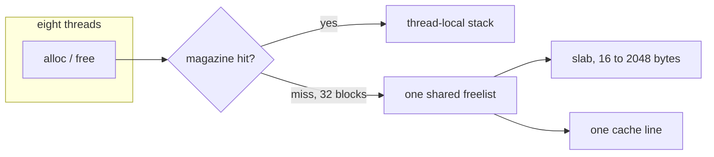
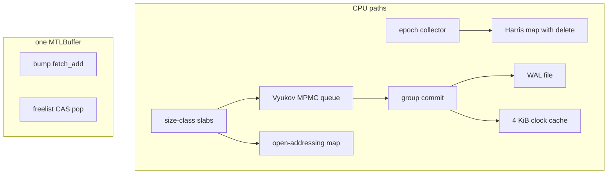
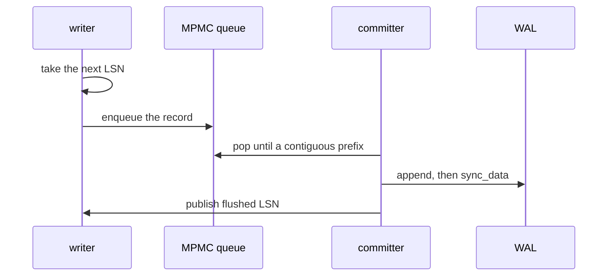

<p align="center">
  
</p>

<p align="center">
  
  
  
  
</p>

A Rust workspace that allocates, publishes, deletes, and logs, then prints the cost of each choice on one Mac.

It is a slab allocator with a thread cache, a bounded lock-free queue, two hash maps, an epoch collector, a page cache with a write-ahead log, and a Metal suballocator. Safe Rust owns the algorithms. `unsafe` is limited to the slab backing store, queue slots, retired map nodes, and Metal timestamps. Each site states the invariant that makes it sound.

Run it:

```sh
cargo test
cargo run --release
cargo run --release -- gaps
```

Release is the number that matters. Debug builds keep double-free checks and do not inline the same way.

---

## What this is

Eight threads allocate and free 64-byte blocks. The question is where the time goes.



A hit never touches the shared list. A miss does, and every miss from every thread lands on the same line. That is the whole allocator result: **343 M/s with a thread cache, 1.3 M/s for the lock-free freelist alone.**

The rest of the repo is the same question in other shapes.

| question | where it shows up |
| --- | --- |
| Who owns a freed block while another thread might still read it? | epoch collector, Harris map |
| When is a write durable, and what is a lie? | WAL, group commit, page cache |
| What does a cache miss cost once the working set leaves L2? | pointer chase |
| Does a GPU want a freelist? | Metal bump versus CAS pop |



---

## The machine

| | |
| --- | --- |
| chip | Apple M5, 10 CPU cores, 24 GB RAM |
| line | 128 bytes |
| L1 data | 64 KiB |
| L2 | 6 MiB |
| `hw.cachesize` | about 3.2 GiB, the system cache in front of DRAM |
| clock | `mach_absolute_time`, 41 ns per tick |
| build | `lto = thin`, `codegen-units = 1`, `target-cpu=native` |

Every table below is one release run on that machine: `cargo run --release -- cpu`, `cargo run --release -- gpu`, and `cargo run --release -- gaps`. Absolute rates move between runs. The ranking is the result.

**M/s** is total work across threads. **ns/op** is the average on each thread (`seconds × threads / ops`). A fast 8-thread run can show a huge M/s and a small ns/op at the same time. Both are right.

---

## Results

### Allocation, 64-byte alloc + free

The 1-thread column and the 8-thread column tell different stories. Lock-free wins alone. It collapses when eight cores share the head.

| design | 1 thread | 8 threads |
| --- | ---: | ---: |
| system malloc | 39 M/s, 26 ns | 130 M/s, 61 ns |
| mutex, blocking | 44 M/s, 23 ns | 17 M/s, 475 ns |
| mutex, spin | 46 M/s, 22 ns | 2.0 M/s, 4.0 µs |
| mutex, spin + thread cache | 45 M/s, 22 ns | 338 M/s, 24 ns |
| lock-free | 86 M/s, 12 ns | 1.3 M/s, 6.0 µs |
| lock-free + thread cache | 44 M/s, 23 ns | 343 M/s, 23 ns |

Mixed sizes 16 / 64 / 256 / 1024, still 8 threads: system malloc 84 M/s, spin + cache 300 M/s, lock-free + cache 279 M/s.

A plain bump pointer, which never frees, is the ceiling: **711 M/s, 1.4 ns** on one thread. Eight threads sharing one atomic bump fall to **24 M/s, 328 ns**. The shared cursor is the same bottleneck as the shared freelist.

### Tail latency, 8 threads

p50 / p99 / p99.9 of one alloc+free. The timer cannot see anything finer than 41 ns.

| design | p50 | p99 | p99.9 |
| --- | ---: | ---: | ---: |
| mutex, spin | 2.2 µs | 100 µs | 611 µs |
| mutex, spin + thread cache | 41 ns | 41 ns | 125 ns |
| lock-free | 3.2 µs | 34 µs | 61 µs |
| lock-free + thread cache | 41 ns | 41 ns | 125 ns |

41 ns means "under the clock," not "this allocation took 41 ns."

### False sharing and ordering

Eight private counters. Packed ones share a 128-byte line. Padded ones do not.

| layout | throughput | per thread |
| --- | ---: | ---: |
| packed | 162 M/s | 49 ns |
| padded to 128 bytes | 3220 M/s | 2.5 ns |

One shared atomic, 8 threads, `fetch_add`: relaxed 39 M/s, acqrel 31 M/s, seqcst 46 M/s. The spread is the line bouncing between cores. On a single run the order can swap. `SeqCst` is not what makes the structures correct, and it is not what makes them fast.

### Queues

Successful pushes plus successful pops. The lock-free queue is Vyukov's bounded MPMC. The mutex queue is a spin lock around a `VecDeque`.

| design | throughput | per thread |
| --- | ---: | ---: |
| mutex, 1 producer / 1 consumer | 5.0 M/s | 403 ns |
| lock-free, 1 / 1 | 183 M/s | 11 ns |
| mutex, 4 / 4 | 1.7 M/s | 4.6 µs |
| lock-free, 4 / 4 | 11 M/s | 758 ns |

### Maps that never delete

90% get, 10% in-place update, 8 threads, 32768 keys.

| design | spread across keys | one hot key |
| --- | ---: | ---: |
| one mutex | 11 M/s, 762 ns | 9.5 M/s, 846 ns |
| 16 shards | 36 M/s, 222 ns | 4.0 M/s, 2.0 µs |
| lock-free open addressing | 2292 M/s, 3.5 ns | 118 M/s, 68 ns |

Shards win while keys spread out. A hot key puts every thread back on one shard, and that shard is slower than the single mutex because the shards are still spinning. The open-addressing map has no delete, so a slot is written once and read after that.

### Delete, with an epoch

Same shape of workload, except 10% of operations remove a key and insert it again. Removed nodes are really freed.

| design | 8 threads | nodes reclaimed |
| --- | ---: | ---: |
| `Mutex<HashMap>` | 4.1 M/s, 1.9 µs | 0 |
| epoch-protected Harris chain | 23 M/s, 341 ns | 468189 |

### Group commit

4 writers, 1 committer, 16-byte records, 8 hot pages. Each writer keeps 64 records in flight, then waits until its prefix is durable.

| mode | throughput | per writer | syncs | records / sync |
| --- | ---: | ---: | ---: | ---: |
| sync every record | 0.3 K/s | 14 ms | 320 | 1.0 |
| batch of 32 | 7.9 K/s | 504 µs | 56 | 32.0 |

`records / sync` landed on the batch size. That is the check that the committer published a whole prefix and not a torn one.

### Working set

One dependent load per 128-byte line, through a single cycle, then a sequential scan of the same buffer.

| working set | dependent load | sequential scan |
| --- | ---: | ---: |
| 32 KiB | 2.7 ns | 475 GB/s |
| 256 KiB | 6.3 ns | 153 GB/s |
| 2 MiB | 13 ns | 81 GB/s |
| 8 MiB | 16 ns | 71 GB/s |
| 64 MiB | 157 ns | 16 GB/s |

32 KiB fits in L1. 2 MiB fits in the 6 MiB L2. 8 MiB is just past L2 and stayed near the 2 MiB cost: the 3.2 GiB system cache absorbed it. 64 MiB is the first size that left L2. It can still be inside that system cache. A DRAM miss needs a chase larger than `hw.cachesize`.

### GPU

Apple M5, Metal, shader compiled at runtime. 65536 threads.

| kernel | rate | device time |
| --- | ---: | ---: |
| bump `fetch_add`, 32 repeats | 10032 M/s | 209 µs |
| freelist CAS pop, 4 repeats | 0.23 M/s | 1138 ms |

| way of getting a pointer | cost |
| --- | ---: |
| 4096 separate 4096-byte `MTLBuffer`s | 9.1 ms total, 2.2 µs each |
| one `MTLBuffer` covering the same bytes | 8.5 µs |
| CPU suballoc inside that buffer | 550 ns |

The GPU bump is one atomic add. The GPU freelist is one contended CAS, and every thread takes it. Pop-only, so the GPU list does not need the CPU's ABA tag.

---

## How it works

### The slab

Eight size classes, 16 through 2048 bytes. Each class is one allocation of about 8 MiB, carved into fixed slots. The freelist stores `u32` indexes, not pointers. `u32::MAX` means empty.

A thread cache (a magazine) holds up to 64 indexes. It refills and returns them 32 at a time. On a hit, alloc and free are a push and pop on a `Vec` that only that thread touches.

The shared list is one of two things:

- a `Mutex`, either blocking or spinning on `try_lock`
- a Treiber stack whose head is `(generation << 32) | index`

The generation is the ABA tag. A pop that stalled must not succeed after that index was freed and reused. Push stores `next`, then Release-CASes the head. Pop Acquire-loads the head, then reads `next`.

### Publishing a value

Apple Silicon is weakly ordered. The rule used everywhere is the same: write the payload, then release-publish the flag the reader waits on. The reader acquire-loads the flag, then reads the payload.

| structure | payload | publish |
| --- | --- | --- |
| freelist | `next` index | Release CAS of the head |
| MPMC queue | slot value | Release store of `sequence = pos + 1` |
| open-addressing map | key and value | Release store of `ready` |
| Harris list | node fields | AcqRel CAS that swings the predecessor |

`Relaxed` is for counters that do not publish other bytes. The structures do not use `SeqCst`.

### The queue

Each cell is aligned to 128 bytes so neighboring sequence counters do not false-share. The producer who wins ticket `pos` writes the value, then publishes `pos + 1`. The consumer who sees that sequence reads the value, then publishes `pos + capacity` so a later producer may reuse the cell. The mutex queue is the same API with a spin lock, so the comparison is the protocol, not the benchmark harness.

### Maps

The open-addressing map is fixed. Empty, claimed, ready. Key 0 is reserved. There is no delete, so nothing is freed and no reclamation is required. A get is an acquire load of `ready` and then a relaxed load of the value.

The Harris map is a sorted singly linked list per bucket. The low bit of `next` means logically deleted. Nodes are allocator-aligned, so that bit is free. The thread that successfully swings the predecessor over the node is the only thread that retires it. An insert that loses the race drops its unpublished node immediately. It was never visible, so it does not enter the epoch.

### The epoch

A pinned thread announces the global epoch it observed, with a `SeqCst` fence before it follows any pointer. It clears that announcement when the pin ends.

An object retired in epoch `E` is dropped once the global epoch reaches `E + 2`. A pin that started at `E` does not block the step to `E + 1`. It blocks the step after that, which is the one that would free the object. Three bags are enough because bag `E % 3` is reused at `E + 3`, after those objects were already eligible at `E + 2`.

`ADVANCE_EVERY` is 64. The collector tries to move the epoch every 64 unpins, not on every one. That constant is the knob. Smaller reclaims sooner and takes the participant lock more often.

Drop of a retired value runs on whichever thread notices the epoch has moved, so retired values are `Send`.

### The log

A write is durable when its record is in the WAL and `sync_data` has returned. The page file is a checkpoint of bytes that were already logged.



LSNs are assigned with `fetch_add` before the enqueue, so they can arrive out of order. The committer holds them in a `BTreeMap` and syncs only a prefix with no holes. Publishing LSN 3 while LSN 2 is still in memory would be a bug. Writers wait on the flushed LSN, not on their own enqueue.

Records are absolute: page, offset, bytes. Replay writes those bytes again. Doing it twice matches doing it once. A short or torn tail stops replay and is truncated.

The cache is 4096-byte frames and a clock hand. Evicting a dirty frame syncs the log first if that frame's LSN is ahead of the flushed LSN. The page file does not get ahead of the log.

`WAL_BATCH` is 32, the number of records per `sync_data` while the queue stays full. The frame count is the other knob.

### The GPU

`shaders/gpu_alloc.metal` is compiled with `newLibraryWithSource`. No `metal` CLI. Two kernels:

- `bump_alloc` is `atomic_fetch_add` on one device counter.
- `freelist_pop` is a relaxed load and a relaxed CAS. The kernel never pushes. The CPU installs the links before the dispatch, so the pop is ABA-free. This Metal compiler only accepts `memory_order_relaxed` for device atomics.

A separate measurement allocates thousands of `MTLBuffer`s against one buffer plus pointer arithmetic. Device allocation is a kernel call. Suballocation is not.

### The chase

Nodes are 128 bytes, one line each. `next` is a shuffled cycle, not a random permutation. A permutation is many short cycles, and a short cycle fits in cache even when the buffer does not. The reported load is `Instant` over at least two million dependent steps.

---

## Assumptions

These are the conditions the numbers and the proofs rely on.

**Hardware.** One Apple Silicon chip. The cache line is 128 bytes, not 64. L2 is 6 MiB. The first value of `hw.cachesize` is a system-level cache of about 3.2 GiB, so a working set of 8 MiB or 64 MiB can miss L2 and still hit that cache.

**Memory model.** A release store pairs with an acquire load. That is the publish protocol. The epoch pin adds `SeqCst` fences because the proof is about the epoch counter itself, not about a payload.

**Allocator.** Classes stop at 2048 bytes. A production allocator would mmap anything larger. Each class holds about 8 MiB so a benchmark refill does not empty the pool. The magazine batch is 32 and the cap is 64. Cross-thread free is allowed: the other thread returns the index to the shared list or to its own magazine.

**Queue.** Capacity is a power of two, at least 2. The group-commit queue holds 1024 jobs. A job payload is 1 to 32 bytes. Shutdown is valid after every writer has finished `wait`. A writer that takes an LSN and never enqueues it leaves a hole, and the committer will not skip it.

**Maps.** The open-addressing table does not grow and does not delete. The Harris table does not grow either. Its buckets are fixed at creation. Lists stay sorted by key. Only the unlink winner retires a node.

**Epoch.** The caller pins, then loads, then drops the pin. A pointer used after the pin ends is not protected. Freed objects are `Send`. `ADVANCE_EVERY` delays reclamation on purpose.

**Log.** Replay is idempotent because every record names an absolute range. A crash can lose a page-file write; the WAL rebuilds it. The tests do not claim that an unsynced write is lost, because the operating system may flush it anyway. One committer thread owns `sync_data`.

**Time.** Throughput samples run for 200 ms (`quick` uses 80 ms). ns/op includes every thread. p50 at 41 ns is the timer floor. There are no performance counters. The chase is the cache measurement.

**GPU.** Device atomics in this shader are relaxed. The freelist kernel only pops. The CPU's freelist both pushes and pops, which is why the CPU carries a generation tag and the GPU does not.

---

## What the program prints

`cargo run --release` runs the original suite, CPU then GPU. `gaps` is separate so the original run stays the same length.

| command | what comes out |
| --- | --- |
| `cargo run --release` | ordering, false sharing, slabs, bump, tail latency, queues, maps, GPU |
| `cargo run --release -- cpu` | everything except the GPU |
| `cargo run --release -- gpu` | device name, bump, freelist, buffer costs |
| `cargo run --release -- gaps` | epoch map, group commit, working set |
| `cargo run --release -- epoch` | the delete comparison only |
| `cargo run --release -- wal` | fsync-each against batch 32 |
| `cargo run --release -- cache` | the chase, plus `sysctl` cache sizes |
| `cargo run --release -- quick` | same as the full run, 80 ms samples, smaller GPU grid |
| `cargo test` | 31 tests: ABA-free reuse, MPMC delivery, pin blocks a free, torn WAL, clock eviction, one chase cycle |

Each section ends with a line that says how to read it. The allocator block looks like this:

```text
allocation throughput, 64-byte alloc+free
  design                     1 thr M/s    ns/op    8 thr M/s    ns/op
  system malloc                 39.06     25.6      130.21     61.4
  mutex blocking                44.07     22.7       16.84    474.9
  mutex spin                    46.02     21.7        2.02   3967.7
  mutex spin + tcache           45.01     22.2      337.67     23.7
  lock-free                     86.22     11.6        1.33   6037.1
  lock-free + tcache            44.39     22.5      342.87     23.3
```

Knobs, if you want to move a number:

| knob | file | what it changes |
| --- | --- | --- |
| `ADVANCE_EVERY` | `src/epoch.rs` | how often a thread tries to advance the epoch |
| `WAL_BATCH` | `src/store.rs` | records per `sync_data` while the queue is full |
| frame count | `Store::create` | how many 4 KiB pages stay resident |
| chase sizes | `src/gaps.rs` | which working sets get timed |
| sample length | `src/main.rs` | 200 ms, or 80 ms for `quick` |

---

## Where the code lives

| piece | file | unsafe? |
| --- | --- | --- |
| size classes | `src/alloc` | backing `alloc` / `dealloc` only |
| mutex freelist | `src/alloc/mutex_alloc.rs` | no |
| tagged Treiber freelist | `src/alloc/lockfree.rs` | no, indexes rather than pointers |
| thread cache | `src/alloc/tcache.rs` | no |
| bump and atomic bump | `src/alloc/bump.rs` | no, beyond the slab |
| mutex queue and Vyukov queue | `src/queue.rs` | slot read and write, gated on the sequence word |
| mutex map, shards, open addressing | `src/map.rs` | no |
| epoch collector | `src/epoch.rs` | drop of a retired allocation, two epochs later |
| Harris map | `src/epoch_map.rs` | node links; the unlink winner retires the node |
| page cache and WAL | `src/store.rs` | no |
| pointer chase | `src/workingset.rs` | no |
| release/acquire pair | `src/ordering.rs` | no |
| Metal kernels | `shaders/gpu_alloc.metal`, `src/gpu.rs` | timestamp message sends and buffer reads |

---

## What this does not prove

- Neither map resizes. The open-addressing map does not delete.
- There is no fragmentation curve against jemalloc or mimalloc. The allocator numbers are against the system allocator and the designs in this repo.
- There are no hardware performance counters. A flat step in the chase is a cache hit until the working set passes `hw.cachesize`.
- The log has one committer. It is a group commit and a replay, not a database.
- The mach timer floors at 41 ns. Anything faster is reported as 0 or 41.
